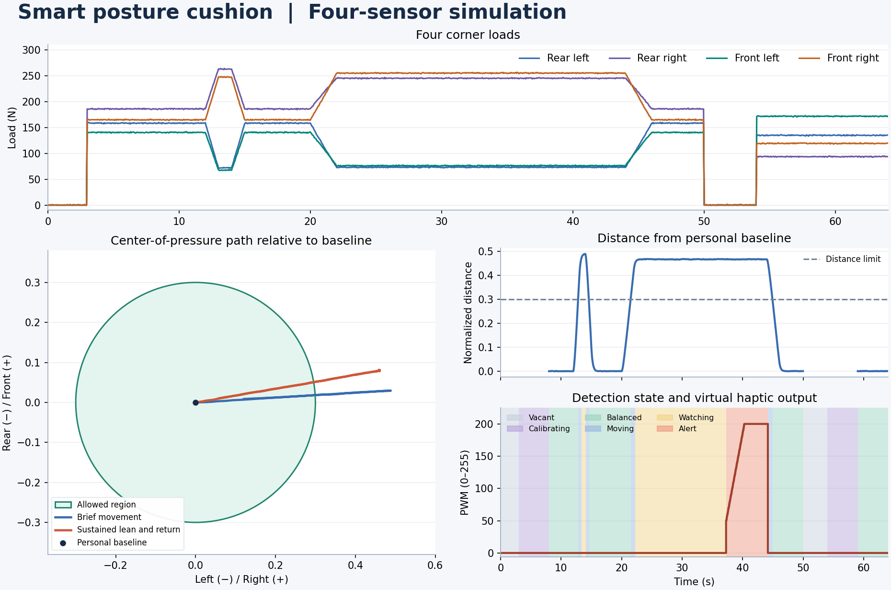

# 자세 교정용 스마트 방석 시뮬레이션

물리학과 AI 코딩 과제 Project 07. 방석 아래 네 모서리에 걸리는 하중으로 **압력 중심**을 구하고, 기준점에서 벗어난 상태가 지속될 때 가상 진동 모터를 켠다. 합성 센서 데이터로 빈 의자, 잠깐의 움직임, 지속 쏠림, 복귀, 재착석을 비교했다. 짧은 움직임에도 허용 범위를 벗어났지만, PWM은 지속 쏠림에서만 켜졌다.

## 웹에서 바로 실행

[**자세 교정 스마트 방석 시뮬레이터 열기**](https://sihyeon10222.github.io/smart-posture-cushion-sim/)

오프라인에서는 [HTML 파일](https://github.com/sihyeon10222/smart-posture-cushion-sim/releases/download/v1.1.0/cushion-simulator.html)을 받아 실행할 수 있다.

3D 장면에서는 압력 중심이 이동하는 쪽으로 착석 모형이 기울고, 센서별 하중이 방석 위 막대에 표시된다. 가상 진동이 켜지면 방석 옆에 주황색 파형과 PWM 값이 나타난다. **반대쪽에서 보기**를 누르면 시점을 바꿀 수 있다. 모형의 기울기와 진동 크기는 동작을 잘 보이게 표현한 값이다.

**짧은 움직임**과 **지속 쏠림** 버튼으로 두 구간의 하중과 알림을 비교할 수 있다. 알림 대기 시간을 25초로 바꾸면 같은 시나리오에서 알림이 켜지지 않는다. 화면의 움직임을 줄이도록 설정한 기기에서는 **재생**을 눌러 시작한다. 아래 Python 명령은 제출한 그래프와 CSV를 재생성한다.



## 시스템 개요 및 하드웨어 구성

| 개념 하드웨어 | 역할 | 시뮬레이션에서 사용하는 값 |
| --- | --- | --- |
| 방석 모서리의 FSR 4개 | 각 지점의 수직 하중을 감지 | 20 Hz로 생성한 좌후·우후·좌전·우전 하중 $F_i$ (N) |
| Arduino Nano | 4채널을 읽고 압력 중심, 기준점, 자세 상태를 계산 | Python 함수가 0.05초 간격으로 판정 |
| 2N2222 드라이버와 코인형 진동 모터 | PWM 명령에 따라 진동 피드백 출력 | 0–255 척도의 정수형 가상 PWM |

FSR 신호는 뉴턴 단위로 변환이 끝난 값으로 가정했다. 그래프의 압력 중심은 네 지점에 분포한 수직 하중의 합력 작용점이다. 사람의 몸 전체 무게중심을 측정하거나 특정 자세를 진단하려면 추가적인 계측과 검증이 필요하다.

## 알고리즘 및 수학적 모델

### 4점 하중과 압력 중심

방석 중심을 원점으로 두고 오른쪽과 앞쪽을 각각 $x$, $y$의 양의 방향으로 정했다. 센서 좌표 $(s_{x,i},s_{y,i})$는 각 축의 반쪽 길이를 단위로 삼아 $\pm1$이다. 총하중 $W$와 입력 중심 $(x,y)$에 대해 모서리별 하중은 다음과 같다.

$$
F_i = \frac{W}{4}(1 + s_{x,i}x)(1 + s_{y,i}y)
$$

이 배분의 합은 $W$이며 각 센서에 표준편차 0.5 N의 가우시안 잡음을 더하고 음수는 0 N으로 처리한다. 정적 평형에서 합력이 만드는 모멘트를 개별 하중의 모멘트 합과 같게 놓으면 압력 중심 $\mathbf{c}$를 구할 수 있다.

$$
\mathbf{c} = \frac{\sum_{i=1}^{4}F_i\,(s_{x,i},s_{y,i})}{\sum_{i=1}^{4}F_i}
$$

총하중이 50 N 미만이면 미착석으로 처리하고 계산과 알림을 멈춘다. 잡음이 없는 경우 입력 중심과 계산한 중심은 일치한다. [OpenStax 정적 평형 조건](https://openstax.org/books/university-physics-volume-1/pages/12-1-conditions-for-static-equilibrium)

### 착석 기준점과 지속 시간 판정

착석 직후 5초 동안 모은 100개 압력 중심의 평균을 개인 기준점 $\mathbf{c}_0$으로 삼는다. 이후 측정값 $\mathbf{c}_k$는 지수 이동평균으로 평활화한다. 필터의 초기값은 $\mathbf{c}_0$이다.

$$
\tilde{\mathbf{c}}_k = 0.2\,\mathbf{c}_k + 0.8\,\tilde{\mathbf{c}}_{k-1}, \qquad
d_k = \lVert\tilde{\mathbf{c}}_k-\mathbf{c}_0\rVert, \qquad
v_k = \frac{\lVert\tilde{\mathbf{c}}_k-\tilde{\mathbf{c}}_{k-1}\rVert}{0.05\,\mathrm{s}}
$$

- $d_k \leq 0.30$이면 허용 범위 안으로, 범위 밖에서 $v_k > 0.10\,\mathrm{s}^{-1}$이면 이동 중으로 분류한다. 두 경우 모두 지속 시간과 PWM을 0으로 되돌린다.
- $d_k > 0.30$이면서 $v_k \leq 0.10\,\mathrm{s}^{-1}$인 상태가 **15초 연속** 이어지면 알림이 시작된다. PWM은 50에서 시작해 3초 동안 선형으로 200까지 오른다.
- 일어나면 이전 기준점을 지운다. 다시 앉으면 새로 100개를 모아 기준점을 구한다. 초기 보정 중에는 알림을 끈다.

## 실행 및 결과

Python 3.12 환경에서 저장소 폴더를 열고 다음을 실행한다.

```sh
python3.12 -m venv .venv
source .venv/bin/activate
python -m pip install -r requirements.txt
python simulate.py --output-dir results
```

고정 난수 시드 42로 64초에 걸친 1,280개 샘플을 생성한다. 출력은 [결과 그래프](results/overview.png)와 [요약 CSV](results/summary.csv)다.

| 확인 항목 | 기본 시나리오 결과 |
| --- | --- |
| 압력 중심 RMS 오차 | 착석 샘플 1,140개에서 정규화 좌표 기준 0.00235 |
| 빈 의자 및 짧은 움직임 | PWM 0 유지. 짧은 움직임도 거리 0.30을 넘었으나 15초를 채우지 못함 |
| 지속 쏠림 | 22.25초에 거리와 속도 조건을 모두 충족. 37.25초에 PWM 50, 40.25초에 PWM 200 |
| 복귀 | 44.15초에 평활화한 중심의 속도가 기준을 넘으며 PWM 0 |
| 재착석 | 기준점이 $(0.07998,-0.05993)$에서 $(-0.18014,0.12007)$로 새로 설정됨 |

FSR의 비선형 응답과 히스테리시스, 실제 모터 응답은 모델에 포함하지 않았다. 알림 결과는 위의 합성 시나리오와 정해진 임계값에 대한 동작을 보여준다.

## 바이브 코딩 프롬프트 시퀀스

1. 20 Hz의 4점 하중을 생성하고 압력 중심의 기준 동작을 확인했다.
2. 착석 기준점과 거리·속도 판정을 추가해 알림이 켜지고 꺼지는 시점을 확인했다.
3. 같은 시나리오의 그래프와 수치 요약을 생성하고 실행법을 정리했다.
4. 같은 판정 로직으로 시나리오를 재생하고 알림 대기 시간을 바꿀 수 있는 단일 HTML 시뮬레이터를 추가했다.
5. 압력 중심에 따라 기울어지는 착석 모형과 모서리 하중을 3D 장면으로 표시했다.

단계별 요청과 확인 결과는 [프롬프트 기록](PROMPTS.md)에 있다.
